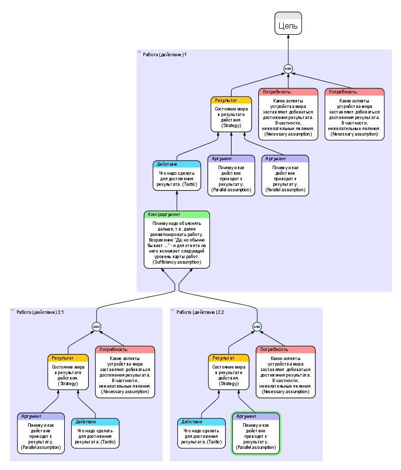

# R4.5:3 - Карты действий и результатов

Причинно-следственный анализ является методом решения чётко поставленных проблем в конкретной предметной области. Поэтому мы много внимания посвятили вопросу обнаружения проблем: распознаванию слабых сигналов, дребезга, поиску источника, конкретизации проблемы, усиления сигналов. Но что делать, если наша проблема – это желание создать что-то новое, достичь какой-то цели «*с чистого листа*»?

Для абстрактных высокоуровневых проблем (например, «*как* з*аработать денег*») можно сходу предложить столь же абстрактное решение (например, «*создать свой бизнес*»), но даже явная причинно-следственная связь в этом случае не слишком помогает искать специализированные и более конкретные вмешательства, делать выбор и реализовывать принятое решение. Для *высокоуровневого стратегического планирования* имеет смысл использовать специально разработанные для этого методы, и таких методов вы можете найти множество. Легко ищется информация про *SWOT анализ*, *Сбалансированную систему показателей*, *Porter's Five Forces* и многое иное.

Мы хотим показать вам метод построения «***Деревьев стратегии и тактики***» (*Strategy & Tactic Tree*), разработанный Элияху Голдраттом, на работы которого в области менеджмента мы уже неоднократно ссылались. Этот метод привлекателен своей непосредственной связью с причинно-следственным анализом, которым мы занимались ранее, вы легко проследите эту связь. После проведения причинно-следственного анализа, если у вас уже есть граф причинно-следственных связей вашего *позитивного сценария* (*сценария вмешательства*), дерево Голдратта создаётся на его основе путём приведения найденных связей в более простую и сфокусированную форму, удобную для окончательной логической проверки полноты рассуждений, и далее – для коммуникации, для донесения вашей логики до других агентов и согласования с ними совместных действий.

Дальнейшее изложение метода основано на статье «**Strategy and Tactics**» ***Eli Goldratt, Rami Goldratt, Eli Abramov*** ([https://public.archive.wsu.edu/engrmgmt/public_html/holt/em534/Goldratt/Strategic-Tactic.html](https://public.archive.wsu.edu/engrmgmt/public_html/holt/em534/Goldratt/Strategic-Tactic.html)), с адаптацией русскоязычной терминологии, которую мы будем комментировать по ходу дела. Мы опишем основные объекты онтологии, используемой для построения этих моделей, их связи и накладываемые этой методологией ограничения на размещение объектов в модели.

**1. Стратегия и Тактика – Результат и Действие**

Стратегией принято называть постановку целей самого высокого уровня. *Стратегия* и *цели* в этом контексте – синонимы, хотя мы можем иногда выделять *Цель* самого высокого уровня, и называть *Стратегией* уже её конкретизацию (а можем этого и не делать). Стратегия диктует (или ограничивает) направление всех предпринимаемых действий. *Тактика* – это и есть выбранные *действия*, нужные для достижения цели (реализации стратегии).

Вроде бы есть согласие, что главной целью фирмы является «*Делать деньги сейчас и в дальнейшем*». Эта цель и является стратегией организации, но можно ли сказать, что далее всё, что нужно для достижения этой цели, можно рассматривать в качестве тактики? Если мы хотим, чтобы стратегия определяла ясное направление, то ответ тут «*нет*»: только установить цель высшего уровня недостаточно. Поэтому обычно стратегия включает дополнительные цели, являющиеся предпосылками для достижения цели высшего уровня. Для фирмы в качестве стратегии мы рассматриваем и такие цели, как *«Высокая степень удовлетворённости потребителей»*, «*Обеспечение низких цен*». Когда и эти цели оказываются слишком общими, вырабатываются всё более и более конкретные цели, такие, как: «*Качество*», «*Размещение производства в третьих странах*» и т.д. Эти более конкретные цели рассматриваются как предпосылки для целей более высокого уровня. Цели более низкого уровня становятся более и более конкретными.

Тут мы уже видим, что стратегия имеет иерархическую структуру. Есть несколько уровней стратегии, соединённых необходимыми условиями – цели нижнего уровня являются предпосылками для целей более высокого уровня.

|   |
| --- |

Возникает вопрос: «*Не являются ли более конкретные цели тем, что мы называем тактикой*?» Но интуиция говорит нам, что *стратегия* и *тактика* являются понятиями, различными по природе. Эта разница не должна определяться исключительно уровнем детализации.

Стратегия отвечает на вопрос «*Для чего?*», и предполагается, что тактика укажет нам «*Как предполагается достигнуть целей?*», то есть ответит на вопрос «*Как?*». Именно поэтому неверно утверждение, что стратегия должна определяться на верхних уровнях, а тактика – на нижних. Оказывается, стратегия и тактика должны быть определены на любом уровне, независимо от степени детализации.

*Целенаправленными действиями* (или просто ***Действиями***) мы будем называть то, что Голдратт в своей терминологии называет *«Тактическим элементом», Tactic entity*. Для каждого Действия – мы должны иметь возможность задать вопрос «*Почему мы это делаем? Какова **цель** этого действия?*» Ответы на этот вопрос мы назовём ***Результатом*** (в оригинальной терминологии Голдратта это называется *«Стратегическим элементом», Strategy entity*). Тем самым в онтологии этого метода **для каждого Действия должен быть соответствующий Результат.**

И наоборот, для каждой обозначенной цели, Результата, мы должны задать вопрос «*Как нам достичь этого? Какие действия нужны для достижения этой цели?*» Ответы на эти вопросы и есть то, что мы определили, как Действия. Это означает, что в онтологии этого метода **для любого Результата должно быть соответствующее Действие.**

Может ли для одного Результата определяться несколько Действий? Может, если одного Действия недостаточно, нужно несколько, каждое из которых необходимо и вносит свою, необходимую для достижения цели составляющую, а без всех составляющих цель не достигается. Поэтому, увидев несколько Действий, стоит подумать о том, что каждое из них достигает своего Результата. Но тогда для достижения *Результата1* необходимо достичь нескольких промежуточных результатов (*Результаты 2, 3 и 4*).

Поэтому самый общий принцип мы сформулируем в следующей форме:

**Для любого Результата существует только одно Действие, если же их более одного, то Действия должны быть альтернативны друг другу.**

**2. Построение карты (дерева)**

Итак, для *Результата 1* есть *Действие 1*, которое нужно предпринять для получения *Результата 1*. Мы можем найти *Результат 2* и *Результат 3*, которые являются ***предпосылками*** для получения *Результата 1.* А *Действие 2* и *Действие 3*, которые нужно предпринять для получения *Результата 2* и *Результата 3*, являются ***детализацией*** *Действия 1.*

По этому принципу ***Карта действий и результатов*** (так мы будем называть голдраттовской дерево *Стратегии и тактики*) разворачивается сверху вниз, от глобальной Цели (Результата верхнего уровня) до детализированного плана конкретных действий нижнего уровня.

Разворачивание может идти разными способами. Иногда мы сразу видим предпосылки (пререквизиты) для *Результата 1*, формулируем *Результаты 2, 3, 4* и т.д. и ищем обеспечивающие их *Действия 2, 3, 4* … Иногда нам сразу приходят в голову *Действия 2, 3, 4*…, детализирующие *Действие 1*. В Этом случае надо обязательно задуматься – а ***зачем*** именно мы будем осуществлять эти действия, какой *результат* принесёт *каждое из них по-отдельности*, и как именно эти промежуточные результаты *обеспечат результат верхнего уровня*? Найдя ответы на эти вопросы, мы получим корректное заполнение этого уровня.

Подчеркнём, что нам всегда следует обнаружить и **запланировать более одного действия для обеспечения результата более высокого уровня** (и, тем самым, найти более одной предпосылки для этого результата). Если же нам уже не приходит в голову более одного действия (и более одного промежуточного результата), это означает, что мы не видим больше деталей, а просто описываем то же самое другими словами. Это – признак того, что декомпозиция закончена. Следует ещё раз подумать над найденными Действиями самого низкого уровня. Если они ясны и реализуемы – план создан. Если они всё ещё абстракты – надо продолжить их заземление, сохраняя принцип: *одно действие верхнего уровня детализируется несколькими*.

**3. Аргументы**

Для каждого уровня мы утверждаем, что *Действие* приведёт к достижению *Результата*. Это утверждение может быть оспорено несколькими способами:

1. Не требуется никакого действия для достижения результата.

2. Невозможно выполнить это действие.

3. Существует другое, лучшая действие.

4. Требуется ещё какое-то дополнительное действие.

Ответы на эти возражения фиксируются в карте в виде узлов специального типа ***Аргумент**.* (В оригинальной терминологии Голдратта этот тип узлов называется *Parallel Assumption*, скорее всего слово *parallel* напоминает, что "*стратегия и тактика -- это параллельные стороны одной медали, они нераздельны и связаны*", и это как раз аргументы для связи "*параллельных сторон медали*".)

Аргумент как раз показывает, что *Действие необходимо* (ответ на 1), или что *Действие достаточно* (4), или даёт дополнительные пояснения по ситуации (ответ на 2 и 3). Возможно наличие нескольких Аргументов, для удобства анализа возражений.

Как формулировать хорошие Аргументы:

- Поймите, что препятствует достижению Результата.
- Объясните, почему для выполнения Действия не требуется больше ничего, кроме уже записанного в нём самом.
- Опровергните менее подходящие альтернативные действия (другие тактики).
- Докажите, что действие возможно (предполагается, что детализация нижнего уровня подтвердит это).

Пример: Компания Х является некоммерческой компанией, работающей в рамках заданного извне бюджета для достижение некой внешней Цели.

Была поставлена цель (Результат, стратегия): «*Ликвидирован разрыв между потребностями в финансировании для достижения Цели и средствами в выделенном бюджете*»

Выбрано следующе Действие (тактика) следующий: *«Получить чистый доход, достаточный для закрытия разрыва между потребностями в финансировании для достижения Цели и средствами в выделенном бюджете»*.

На первый взгляд, действие можно принять за иную формулировку цели. Но обратите внимание, как проясняется ситуация в результате добавления следующих Аргументов:

- Невозможно изменить Цель.
- Урезание расходов неизбежно разрушит способность компании Х добиваться своей Цели.
- Невозможно увеличить бюджет.
- Есть возможность дополнительно получать чистый доход.

**4. Потребность**

Каждый результат представляется нам необходимым для достижения результат более высокого уровня. Для пояснения этой необходимости в карте предусмотрен узел типа ***Потребность***. (В оригинальной терминологии Голдратта этот тип узлов называется *Necessary Assumption.*)

Тут рекомендуется явно указывать, какие аспекты в нашей картине мира заставляют нас хотеть данного Результата, в частности, какие именно нежелательные обстоятельства, создающие проблемы, мы выявили). *Потребности* должны быть указаны ясно и подробно. Они объясняет, почему данный Результат вообще необходим для достижения Результата более высокого уровня. *Потребностей* может быть несколько.

Как получить хорошее описание *Потребности:* задумайтесь о возражении *«этот результат вообще не нужен».* Запишите свои соображения как *Потребности*, они объяснят, почему это необходимо, почему этот шаг важен.

**4. Контраргумент**

Для каждой группы *Действий* мы заявляем, что эта группа достаточна для успешного достижения *Результата* уровнем выше. Следует привести точный и ясный ***Контраргумент***, подтверждающий это заявление. (В оригинальной терминологии Голдратта этот тип узлов называется *Sufficiency Assumption.*)

*Контраргумент* объясняет необходимость дальнейшей декомпозиции (мы выбрали это название чтобы подчеркнуть важную функцию этого узла – объяснить, почему нельзя остановиться на достигнутом). Исходный термин Голдратта подчёркивает вторую его функцию: пояснить, почему Результаты уже разработанного нижележащего уровня являются предпосылками для достижения результата верхнего уровня и достаточны для достижения этого результата.

В карте может быть несколько Контраргументов. Хороший Контраргумент может:

- Опровергать некоторое дополнительное условие, которое кто-то предлагает, как необходимое обоснование для действий.
- Указывать, что определённое условие уже существует и не требуется других действий для его достижения.

**5. Дополнительные рекомендации**

- Про альтернативы.

В карте есть только два места, где могут быть отражены альтернативы:

1. Внутри уровня, в соединении между *Результатом* и *Действием*. Альтернатива означает, что для данного *Результата* существуют альтернативные *Действия*, между которыми возможен выбор.
2. Между уровнями. В этом случае альтернатива означает, что есть другая группа шагов (пар *Результат-Действие*) на нижележащем уровне, которая может быть достаточна для успешного выполнения *Действия* верхнего уровня.
  - Множественность родителей.

Может быть так, что какой-то *Результат* и обеспечивающее его *Действие* участвуют в достижении двух различных *Результатов* более высокого уровня, или даже что группа *Действий* будет помогать достичь разных *Результатов* более высокого уровня. Это может быть отражено в карте, мы не будем на этом специально останавливаться.

- Вспомогательные действия

Бывают *Действия*, которые хотелось бы предпринять не потому, что они абсолютно необходимы для достижения *Результатов* более высокого уровня, а потому, что они повлияют на вероятность или степень достижения этих *Результатов*. Мы не будем останавливаться на работе с такими действиями, но отметим, что включение их в карту требует указания для них и промежуточных Результатов, в соответствии с общим правилом – однозначное соответствие действий и результатов.

- Работа со временем

Карта Действий и Результатов определяет в первую очередь методы деятельности, поэтому её объекты существуют в особом методологическом времени. Превращение *Действий* карты в *работы*, помещаемые в план-график с назначенными приоритетами, временем начала, плановой длительностью – отдельная деятельность, в этом руководстве мы не будем её обсуждать.
