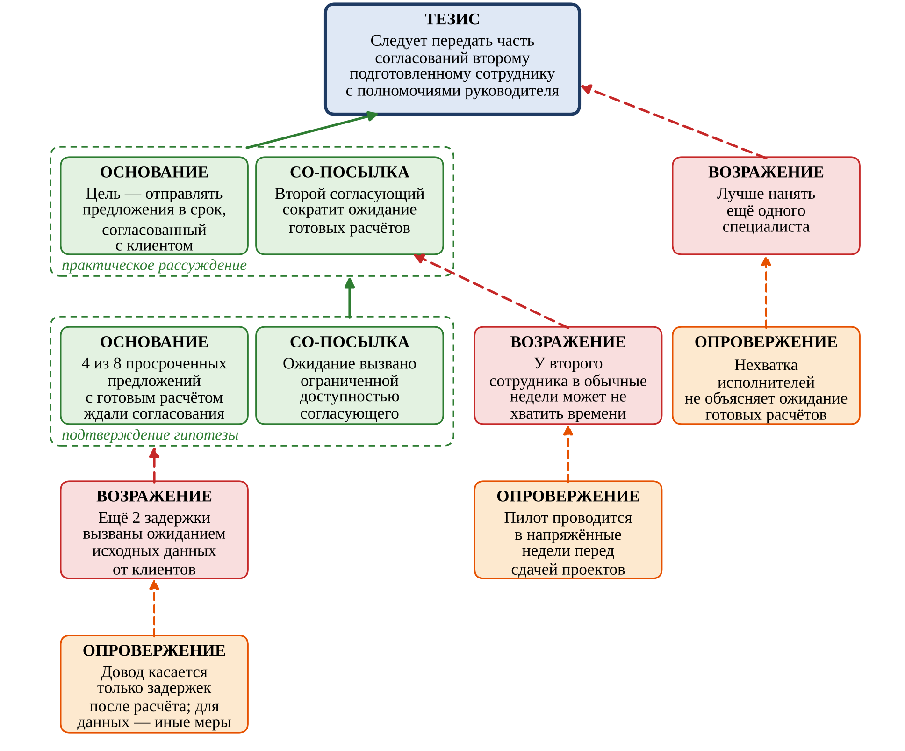

# R4.5:4 - Аргументационные схемы

В предыдущем разделе мы видели, что каждое утверждение карты действий и результатов может быть обсуждено, оспорено, и потребовать защиты. Обоснования и ответы на возражения записываются в карте в виде узлов *Аргумент*, *Потребность* и *Контраргумент*. Ещё ранее, в резидентуре **R2,** мы обсуждали ***базовую схему аргументации***: *тезис, свидетельство, связка и модификатор*. Обсудим подробнее, откуда стоит брать аргументы, как понять, что аргумент хорош, как увидеть слабое место в рассуждении, которое кажется логичным? Для этого в мы познакомимся со специальными методами *теории аргументации,* с их онтологией, мета-моделями и моделями:

- ***Аргументационные схемы*** (*argumentation schemes*) — это типовые шаблоны рассуждений с заранее известными уязвимыми местами.
- ***Карты аргументов*** (*argument maps*) — это наглядное представление развёрнутых конкретных рассуждений: что из чего следует, что чему возражает.

Эти виды моделей ещё расширят наш арсенал графовых моделей. Даже производственные цепочки, с которых мы начинали резидентуру, являются по сути графами, и моделируют потоки реальных вещей. Они дают нам обширные материалы для дальнейших наблюдений и рассуждений, для работы с информацией.

Совсем близкими родственниками являются *причинно-следственные графы*, *карты действий и результатов*, и *аргументационные схемы*, к которым мы приступаем. Но каждая из этих моделей возникла в своём контексте: графы причинности появились как инструмент для понимания и анализа сложных проблем, карты действий и результатов – для планирования корпоративных стратегий. Карты аргументов возникли для планирования и анализа коммуникаций, когда вам уже известно, ***что*** вы хотите объяснить, и теперь работаете над тем, ***как*** это сделать.

Примеры, как и раньше, мы будем брать из знакомой ситуации. Компания готовит клиентам *технические предложения*; за неделю восемь из двадцати предложений отправлены позже обещанного срока. Руководитель предлагает нанять ещё одного специалиста, менеджер — внедрить новый инструмент учёта коммуникаций с клиентами (CRM), специалисты жалуются на ожидание исходных данных от клиентов. А у нас есть гипотеза: *готовые расчёты долго ждут согласования единственного руководителя*.

**1. Что такое аргументационная схема**

***Аргументационная схема*** — это шаблон типового рассуждения, пригодный для использования в обычной, не строго контролируемой формально-логической речи. У схемы есть имя (например, «*аргумент от следствия к причине*»), *набор посылок и вывод*, связь между посылками и выводом является *правилом вывода*. Можно сказать, что аргументационные схемы — это элементарные *паттерны рассуждений*, точно так же, как раньше мы говорили о паттернах (методах) действий. Вместо того чтобы каждый раз изобретать способ обоснования, мы узнаём в ситуации знакомый шаблон и сразу знаем, где у него сильные и слабые места.

Идея схематизации рассуждений восходит ещё к Аристотелю, а систематизировал схемы Дуглас Уолтон, канадский учёный, специалист по неформальной логике и теории аргументации. Его каталог содержит около шестидесяти схем, и ему мы обязаны полезной практической находкой — *критическими вопросами*.

Важнейшее свойство реальных аргументационных схем — их ***отменяемость*** (*defeasibility*). Наши рассуждения не строги, их нельзя считать примерами формальной логической дедукции. Вывод при убедительной аргументации принимается *по умолчанию*, но может быть отозван, когда появляется существенное исключение или новые данные.

Классический пример: «*птицы летают; Твити — птица; значит, Твити летает*». Вывод разумен, пока не выяснится, что Твити — пингвин.

В нашем примере: «*Предложения, по которым исходные данные получены полностью, готовятся за три дня; данные по запросу клиента N получены полностью; значит, предложение будет готово через три дня*». Вывод разумен, пока не выяснится, что руководитель, без согласования которого предложение не уходит клиенту, всю неделю в командировке.

В отличие от *дедуктивного* вывода, где исключения не допускаются, *отменяемый* вывод верен «*как правило*», а *вероятностный* ещё и допускает количественную оценку этой неопределённости. Поэтому аргументационные схемы обычно содержат явное указание на *эпистемический статус* вывода. В базовой схеме аргументации мы упоминали в этой связи о *модификаторах*, а в разделе о *«бытовом» байесианстве* — говорили о *степени уверенности*.

При этом схема может быть некорректной с точки зрения формальной логики, но разумной содержательно, с учётом имеющейся у нас информации о причинно-следственных связях. Рассуждение «*если есть огонь, будет дым; дым есть; значит, вероятно, есть огонь*» формально является ошибкой *утверждения по следствию* (*утверждения консеквента)*, но опирается на знание о причинной связи, которого формальная логика не видит. Схемы отражают содержательные, в том числе причинно-следственные, отношения, а не только логическую форму.

Важно отметить, что *отменяемые аргументационные схемы* применяются не только для анализа повседневной коммуникации или менеджерской коммуникации. Эти методы широко применяются в очень серьёзных и ответственных случаях: при *обосновании безопасности* больших инженерных систем, таких, как самолёты и атомные станции. Дело в том, что для сложной системы, любые расчётные модели которой неизбежно основаны на упрощениях и принципиально ограничены, невозможно добиться строгого математического доказательства. ***Инженерные обоснования (assurance cases)*** по своей природе являются *отменяемыми*, их составление и анализ должны учитывать *неустранимую неопределённость* и *вероятность опровержения*. Аргументационные схемы как раз и созданы для таких ситуаций, когда опровержение рассуждений в некоторых случаях неизбежно, к нему надо готовиться. Для этого необходимо правильно понимать, *что именно* обосновано, создавать модели аргументов, явно указывать предпосылки, и ***не пытаться выдавать аргумент за доказательство, то есть за то, чем он вовсе не является***!

**2. Устройство схемы и критические вопросы**

Аргументационная схема записывается как шаблон списка посылок и вывода, при этом в шаблоне строчными буквами обозначают места агентов (*a*, *e*), прописными — места для высказываний (*A*, *B*). Подставив в шаблон конкретные значения, мы получаем конкретный аргумент. Вот, например, схема ***аргумента от позиции знания (Argument from Position to Know)***:

Посылка 1: агент *a* находится в позиции, позволяющей знать, истинно ли *A*.

Посылка 2: *a* утверждает, что *A* истинно.

Вывод: *A* правдоподобно истинно.

Подставим: «*Специалисты, которые сами запрашивают у клиентов исходные данные, находятся в позиции, позволяющей знать, сколько времени уходит на ожидание. Специалисты утверждают, что ожидание данных очень долгое. Значит, правдоподобно, что ожидание данных существенно*».

К схеме прилагается набор ***критических вопросов***, которые применяются при исследовании аргументации, чтобы судить о том, является ли приводимый автором аргумент приемлемым или нет. Такие вопросы могут раскрывать ошибочные или плохо построенные аргументы, указывать на отсутствующие или потенциально неинформативные утверждения, ставить под сомнения допущения, которые должны выполняться, чтобы аргумент был приемлем.

Схема создаёт *презумпцию* в пользу вывода, а каждый критический вопрос, оставшийся без ответа, возвращает *бремя доказательства* автору аргумента. Отменяемые аргументы проверяются в диалоге и укрепляются по мере того, как на критические вопросы находятся ответы. Этот диалог может идти и внутри одной головы, когда вы сами задаёте критические вопросы к своему рассуждению.

Для *схемы от позиции знания* критические вопросы такие:

- Действительно ли *a* находится в такой в такой позиции, чтобы знать?
- Надёжен ли *a как источник*?
- Утверждает ли *a* именно *A*?

В нашем примере у специалистов есть свой интерес объяснить задержки внешней причиной. Это не делает их утверждение ложным, но требует *независимого свидетельства* — например, сопоставления отметок времени запросов и ответов клиентов.

Схемы помогают *распознавать* аргументы в текстах и речи, *восстанавливать пропущенные посылки* (аргументы с неявными элементами называются ***энтимемами***), *оценивать* аргументы через ответы на критические вопросы и *изобретать* их: каталог схем работает как список «*мест*», где стоит искать доводы в пользу своей позиции и возражения против чужой.

**3. Примеры основных схем**

Списки схем разной степени полноты можно обнаружить в интернете, например, на [https://www.reasoninglab.com/patterns-of-argument/argumentation-schemes/waltons-argumentation-schemes/](https://www.reasoninglab.com/patterns-of-argument/argumentation-schemes/waltons-argumentation-schemes/), схемы Уолтона можно найти в его [книге](https://www.amazon.com/exec/obidos/ASIN/080582071X/qid%3D1004935429/ref%3Dsr_11_0_1/102-5042251-6969720) «Argumentation Schemes for Presumptive Reasoning». Для работы со схемами можно найти специальное программное обеспечение, типа системы для работы с аргументацией Rationale ([https://rationaleonline.com/](https://rationaleonline.com/), [https](https://docs.rationaleonline.com/guide/patterns-and-schemes-of-arguments)[://](https://docs.rationaleonline.com/guide/patterns-and-schemes-of-arguments)[docs](https://docs.rationaleonline.com/guide/patterns-and-schemes-of-arguments)[.](https://docs.rationaleonline.com/guide/patterns-and-schemes-of-arguments)[rationaleonline](https://docs.rationaleonline.com/guide/patterns-and-schemes-of-arguments)[.](https://docs.rationaleonline.com/guide/patterns-and-schemes-of-arguments)[com](https://docs.rationaleonline.com/guide/patterns-and-schemes-of-arguments)[/](https://docs.rationaleonline.com/guide/patterns-and-schemes-of-arguments)[guide](https://docs.rationaleonline.com/guide/patterns-and-schemes-of-arguments)[/](https://docs.rationaleonline.com/guide/patterns-and-schemes-of-arguments)[patterns](https://docs.rationaleonline.com/guide/patterns-and-schemes-of-arguments)[-](https://docs.rationaleonline.com/guide/patterns-and-schemes-of-arguments)[and](https://docs.rationaleonline.com/guide/patterns-and-schemes-of-arguments)[-](https://docs.rationaleonline.com/guide/patterns-and-schemes-of-arguments)[schemes](https://docs.rationaleonline.com/guide/patterns-and-schemes-of-arguments)[-](https://docs.rationaleonline.com/guide/patterns-and-schemes-of-arguments)[of](https://docs.rationaleonline.com/guide/patterns-and-schemes-of-arguments)[-](https://docs.rationaleonline.com/guide/patterns-and-schemes-of-arguments)[arguments](https://docs.rationaleonline.com/guide/patterns-and-schemes-of-arguments) ).

Продемонстрируем несколько важных для инженерной и управленческой работы типов схем с примерами:

**Аргумент от мнения эксперта** — подтип *аргумента от позиции знания*.

Посылки: *e* — эксперт в области *D*, к которой относится *A*; *e* утверждает *A*. Вывод: *A* правдоподобно истинно.

Критические вопросы: (1) насколько *e* надёжен как эксперт? (2) является ли *e* экспертом именно в области *D*? (3) что именно утверждал *e*? (4) заслуживает ли *e* доверия лично, нет ли у него заинтересованности? (5) согласуется ли *A* с мнением других экспертов? (6) основано ли утверждение *e* на свидетельствах?

Приглашённый консультант утверждает, что задержки вызваны отсутствием единого инструмента планирования. Ответы на вопросы: он эксперт по учётным системам, но не по производственной цепочке подготовки предложений; консультант продаёт внедрение таких систем, он не видел данных о том, на каком этапе ждут предложения. И вспомните пример из R4.2: если три сотрудника одного вендора софта дают одно объяснение — это не три независимых эксперта, а один источник.

**Аргумент от знака (симптома)** и близкий к нему **аргумент от следствия к причине**.

Посылки: если имеет место *A*, обычно наблюдается *B*; *B* наблюдается. Вывод: правдоподобно, имеет место *A*.

Критические вопросы: насколько сильна связь между *A* и *B*? Нет ли других событий, которые объяснили бы *B* столь же хорошо?

«*Перед согласованием скопилась очередь готовых расчётов — значит, узкое место на согласовании*». Знак работает, только если исключены другие объяснения очереди: возможно, расчёты «*готовы*» лишь по мнению авторов, а на деле ответственный за согласование возвращает их на доработку.

**Аргумент от корреляции к причине.**

Посылка: *A* и *B* коррелируют. Вывод: *A* — причина *B*.

Критические вопросы: действительно ли есть корреляция, а не совпадение на малой выборке? Нет ли третьего фактора, вызывающего и *A*, и *B* (*искажающего фактора*, в терминах графов причинности)? Не обратное ли направление связи? Есть ли механизм (*медиатор*), объясняющий связь?

«*После смены шаблона предложения стали готовиться быстрее, значит, новый шаблон ускорил подготовку*». Как мы обсуждали, одновременно могли измениться нагрузка сотрудников или состав заказов. Без ответов на критические вопросы остаётся только более узкое утверждение: «*сроки изменились после смены шаблона*». Если критические вопросы игнорируются, схема вырождается в известную ошибку *post hoc ergo propter hoc* («*после этого — значит, вследствие этого*»).

**Аргумент от причины к следствию** (**прогноз**).

Посылки: как правило, если происходит *A*, то происходит *B*; *A* происходит. Вывод: произойдёт *B*.

Это очень весомый аргумент. Но и к нему должны быть заданы критические вопросы: насколько сильна причинная связь? Подтверждена ли она свидетельствами? Нет ли факторов, которые помешают *A* вызвать *B*?

«*Если передать часть согласований второму сотруднику, ожидание после расчёта сократится*». Вопрос о мешающих факторах: будет ли он доступен ли он в те недели, когда отсутствует руководитель, и есть ли у него полномочия по крупным контрактам?

**Подтверждение и фальсификация гипотезы, наилучшее объяснение.**

Подтверждение: если гипотеза *H* верна, должно наблюдаться *E*; *E* наблюдается. Вывод: *H* становится правдоподобнее.

Фальсификация: если *H* верна, должно наблюдаться *E*; *E* не наблюдается. Вывод: *H* ложна или нуждается в пересмотре.

Наилучшее объяснение: наблюдаются факты *F*; *H* объясняет *F* лучше, чем альтернативы *H1*, *H2*… Вывод: правдоподобно, верна *H*.

Эти схемы асимметричны. Подтверждение лишь повышает правдоподобие, причём только если наблюдение *более ожидаемо* при *H*, чем при альтернативах (вспомним *отношение правдоподобия* из R4.4). Фальсификация же, при соблюдении допущений, способна опровергнуть гипотезу.

Если верна гипотеза о согласовании, значительная часть потокового времени должна приходиться на интервал между завершением расчёта и утверждением. Обнаружили это соотношение — гипотеза подтверждается; не обнаружили вовсе — её надо пересмотреть.

Критические вопросы к наилучшему объяснению: все ли альтернативы рассмотрены (согласование, ожидание данных, рост доли сложных предложений)? Объясняет ли *H* все факты или только удобную их часть?

Помним: четыре случая поддерживают одну гипотезу, два — другую, и приписать все восемь задержек одной причине было бы ошибкой.

**Практическое рассуждение** — центральная схема про выбор действий.

Посылки: у агента *a* есть цель *G*; выполнение действия *X* ведёт к *G*. Вывод: *a* выберет выполнить *X*.

Критические вопросы: (1) действительно ли *G* желательна, нет ли у агента других целей, конфликтующих с *G*? (2) нет ли альтернативных действий, лучше ведущих к *G*? (3) возможно ли выполнить *X*? (4) каковы побочные, в том числе негативные, последствия *X*?

Сравните эти вопросы с четырьмя способами оспорить связь «*Действие — Результат*» в карте действий и результатов (R4.5:3): не требуется никакого действия; действие невыполнимо; есть другое, лучшее действие; требуется дополнительное действие. По сути это те же критические вопросы практического рассуждения, а узлы *Аргумент*, *Потребность* и *Контраргумент* — записанные ответы на них. Обратите внимание и на то, что первая посылка этой схемы — *предпочтение*, а вывод — *намерение*: схема как раз и описывает переход от одного к другому.

Цель: «*предложения отправляются в согласованный с клиентом срок*». Действие: «*нанять ещё одного специалиста*». Ответы на критическое вопросы: если верна гипотеза о согласовании, нехватка исполнителей не объясняет ожидание уже готовых расчётов, и лучшей альтернативой будет второй согласующий. Другое действие — «*проверять полноту данных и согласовывать срок только после их получения*» — выполнимо и полезно, но вопрос (4) заставляет учесть риск ухода клиентов в период уточнения данных.

**Аргумент от последствий** и родственные ему схемы.

Посылки: если выполнить *X*, наступят хорошие (плохие) последствия. Вывод: *X* следует (не следует) выполнять.

Критические вопросы: насколько вероятны эти последствия? Какие свидетельства это подтверждают? Нет ли последствий противоположного знака?

«*Увеличим обещанный срок — просрочек станет меньше*». Вопрос о последствиях противоположного знака вскрывает главное: клиент ждёт столько же, улучшилось лишь формальное соблюдение обязательств.

К этому же широкому типу аргументов относятся **аргумент от потерь** («*мы уже полгода внедряем CRM, нельзя бросать*»), который становится ошибкой *невозвратных затрат*, если уже вложенное само по себе служит доводом продолжать, и **скользкий склон** («*сегодня разрешим второму сотруднику согласовывать типовые предложения, завтра никто ни за что не будет отвечать*»), к которому главный вопрос — где в этой цепочке точка остановки.

**Аргумент по аналогии** (и близкий к нему **аргумент от прецедента**).

Посылки: случай *C1* похож на случай *C2*; в *C1* верно *A*. Вывод: в *C2* тоже верно *A*.

Критические вопросы: насколько велико сходство? Переносятся ли именно те свойства, от которых зависит *A*? Нет ли существенных различий?

«*В соседнем подразделении ввели второго согласующего, и сроки сократились вдвое, — значит, и у нас сократятся*». Если у соседей предложения ждали после расчёта, а у нас — до расчёта, из-за неполных данных клиентов, аналогия не работает.

**Аргумент от незнания.**

Посылки: если бы *A* было истинно, это было бы известно всем; *A* неизвестно. Вывод: *A* ложно.

Критические вопросы: насколько полно проведён поиск? На ком лежит бремя доказательства? Насколько сильным должно быть доказательство?

«*В CRM нет записей о жалобах клиентов на задержки — значит, ущерба нет*». Схема правомерна, только если жалобы обязательно бы фиксировались. Как мы отмечали в R4.2, отсутствие сведений об ущербе не позволяет записать «*последствий нет*», но не позволяет и без проверки утверждать, что выручка потеряна.

**Аргументы, обращённые к агенту**: **этический аргумент** (от достоинств говорящего), **аргумент от предвзятости**, **обстоятельственный аргумент** (несоответствие слов и поступков).

Руководитель одновременно участвует в принятии решения и является субъектом гипотезы «*всё ждёт его согласования*» (R4.2). Указание на возможную *предвзятость* — законный критический вопрос к его доводам против второго согласующего. Но вывод «*он не хочет делиться полномочиями, поэтому его аргументы ничего не стоят*» — уже ошибка: предвзятость ослабляет доверие к источнику, но не опровергает довод, его нужно проверять по существу.

Ещё несколько частых схем в кратком изложении:

**Популярное мнение, популярная практика.**

Большинство считает (делает) A — значит, A необходимо делать

Например, «*Все конкуренты уже внедрили ИИ в подготовку предложений*».

Критический вопрос: есть ли у большинства основания, применимые к нашей ситуации?

**Установленное правило** и **исключительный случай.**

Правило требует X в ситуациях типа S; данная ситуация — типа S, значит, надо делать X/

Например, «Р*егламент требует подписи руководителя под каждым предложением*, значит, надо анализировать и исправлять систему согласования».

Критический вопрос: не является ли наш случай исключением, для которого правило не применимо или для которого его применение не нужно?

**От обязательства**

Если a взял на себя обязательство A; то a следует действовать согласно A

Например, «*Мы пообещали клиенту срок — его надо выдержать*».

Критический вопрос: не изменились ли обстоятельства, при которых давалось обязательство?

**4. Аргументационные схемы и логические ошибки**

После появления аргументационных схем стало ясно, что большинство традиционных «*логических ошибок*» (*fallacies*) — не какие-то особые неправильные формы рассуждения, а обычные схемы, применённые без ответа на критические вопросы Ошибки *post hoc* — корреляция без проверки на искажающий фактор, утверждение консеквента (утверждение по следствию) — это знак без альтернативных объяснений, *ad hominem* — предвзятость, выданная за опровержение.

Поэтому в споре не стоит навешивать на доводы собеседника ярлыки *логических ошибок* («*Это же post hoc!*»). Вместо этого полезно задать тот критический вопрос, на который довод пока не отвечает. Ощущение *дребезга*, которое возникает при слушании «*логичного*» рассуждения, очень часто сигнализирует именно о пропущенном критическом вопросе.

**5. Карты аргументов**

***Карта аргументов*** — визуальное представление структуры конкретного рассуждения На ней изображаются ***основной тезис*** (*contention*) и ***основания*** (*reasons*), а также ***со-посылки*** (*co-premises*), ***возражения*** (*objections*), ***опровержения*** возражений (*rebuttals*) и ***промежуточные выводы***. В карте аргументов каждый узел — это **законченное утверждение**, которое может быть истинным или ложным, а каждая связь означает «*поддерживает*» или «*возражает*».

Основные структурные **связи утверждений** на карте относятся к следующим типам:

- ***Связанная*** аргументация (*зависимые посылки*): посылки работают только вместе, ни одна не поддерживает вывод без другой. Именно такая группа и есть экземпляр *аргументационной схемы* — основание вместе с со-посылками.
- ***Сходящаяся*** аргументация (*независимые посылки*): несколько оснований поддерживают тезис каждое само по себе. Вместе они делают тезис убедительнее, но опровержение одного не обесценивает остальные.
- ***Последовательная*** (цепная) аргументация: промежуточный вывод сам служит основанием для следующего утверждения (работает как *медиатор*); в ***расходящейся*** цепочке одно основание поддерживает два разных вывода.
- ***Возражение против вывода***: важно понимать, что тут оспаривается не посылка, а сам переход от посылок к выводу. Это ровно то, что делают критические вопросы.

Вот как может выглядеть карта аргументов для предложения передать часть согласований второму сотруднику.

Карта аргументов: передача части согласований второму сотруднику

Основание-цель работает только вместе с со-посылкой-средством, поэтому они объединены рамкой практического рассуждения. Со-посылка сама является промежуточным выводом и поддерживается подтверждением гипотезы (последовательная аргументация). Возражения порождены критическими вопросами схем: «*нет ли лучшей альтернативы?*», «*нет ли мешающих факторов?*», «*объясняет ли гипотеза все факты?*». Последнее опровержение не отвергает возражение, а *сужает область* тезиса — частый и честный исход работы с картой.

Для проверки связанной группы посылок можно использовать два простых эвристических правила:

- ***Правило кролика***: каждый важный объект, участвующий в выводе должен встречаться хотя бы в одной из посылок. Нельзя вытащить кролика из шляпы, если его туда не положили.
- ***Правило держащихся за руки***: каждый важный объект посылки должен встречаться либо в другой посылке, либо в выводе. Если объект более не используется («*висит*»), то либо посылка лишняя, либо не хватает со-посылки, связывающей его с иными объектами.

Довод «*четыре просроченных предложения с готовым расчётом ждали согласования — значит, второй согласующий сократит ожидание*» нарушает правило кролика: в выводе есть «*второй согласующий*», которого нет в посылках. Нужна со-посылка, связывающая ожидание с доступностью единственного согласующего. Именно эта неявная посылка и оказывается самой спорной частью рассуждения.

Можно описать общий *метод построения карты аргументов* с использованием аргументационных схем:

1. Сформулируйте основной тезис (вывод, окончательную гипотезу, требуемое действие) одной законченной фразой.

2. Сформулируйте основные утверждения в имеющихся у вас причинно-следственных цепочках как самостоятельные высказывания, понятные без контекста, и определите, что служит основанием, а что — промежуточным выводом.

3. Для каждого основания определите *аргументационную схему* и восстановите недостающие со-посылки (проверьте *правила кролика* и *держащихся за руки*). Зависимые посылки сгруппируйте, независимые основания изобразите отдельными ветвями.

4. Пройдите по критическим вопросам каждой схемы. Вопросы без ответа превращаются в возражения; если ответ есть — запишите его как опровержение.

5. Оцените, какие ветви устояли. Карта сама по себе не говорит, какое решение принять, это вы уже должны понимать на основании причинно-следственного анализа, или принятой стратегии. Карта показывает, на чём это решение держится и как о нем убедительно рассказывать.

**6. Ещё раз про карты аргументов, графы причинности и карты действий и результатов**

Подведём итоги изучения графовых методов, которым было в значительной степени посвящено это руководство.

Карта аргументов внешне похожа на граф причинности, но стрелка в графе причинности означает, что одно *событие* вызывает другое, а стрелка в карте аргументов — что одно *высказывание* поддерживает другое (это *эпистемическое*, а не *причинное* отношение). Путаницу усиливает связка «*потому что*», которое может встречаться и в *объяснении* («*предложение опоздало, потому что ждало согласования*»), и в *обосновании* («*мы считаем, что оно ждало согласования, потому что расчёт был готов за три дня до отправки*»).

Составление объяснения (графа причинности) *предшествует* аргументации. Можно сказать, что объяснение из графа причинности становится в целом *посылкой* аргумента, а сам аргумент в пользу объяснения строится по схемам *подтверждения гипотезы* и *наилучшего объяснения*. Это не отменяет того, что в процессе аргументации граф причинности может быть поставлен под сомнение, опровергнут, изменён, уточнён.

Карта действий и результатов Голдратта — частный случай карты аргументов для практического рассуждения о стратегии фирмы: каждая пара «*Действие — Результат*» — экземпляр этой схемы, а *Потребность*, *Аргумент* и *Контраргумент* — поддержка основного утверждения и опровержения типовых возражений.

Наконец, вспомним обсуждавшийся в руководстве **R2** основной принцип убеждающей коммуникации: ***аргументация строится от картины мира собеседника***. Для одного тезиса можно построить несколько сходящихся ветвей аргументации, адресованных разным ролям: для операционного менеджера ***— аргумент от знака*** и ***от причины к следствию*** на данных о задержках, для руководителя, отвечающего за бюджет, — ***аргумент от последствий*** в стоимости потерянных контрактов, для методолога — ***аргумент от установленного правила***.

Выбирайте схемы, посылки которых собеседник уже готов принимать в своей роли, исходя из своих интересов, и заранее готовьте ответы на его вероятные критические вопросы. А сами карты храните вместе с прочими моделями в экзокортексе: когда мир даст обратную связь, по карте будет видно, какая посылка не выдержала проверки.
